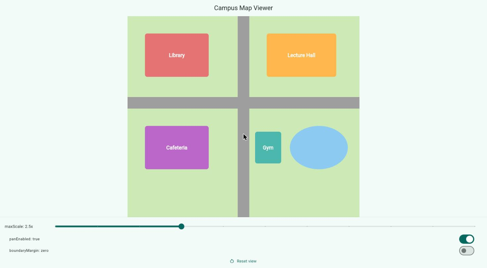

# InteractiveViewer Demo: Campus Map Viewer

InteractiveViewer is a Flutter widget that lets users zoom and pan around any child widget, like a map or a photo.

I built a small campus map (library, lecture hall, cafeteria, gym and a lake) that you can zoom and drag around, with a control panel underneath that changes three of the widget's properties while the app is running.



## How to run

1. Make sure Flutter is installed.
2. Clone this repo and open the folder in a terminal.
3. Run these two commands:

```bash
flutter pub get
flutter run -d chrome
```

In Chrome, scroll the mouse wheel (or pinch on a trackpad) to zoom, and click and drag to move the map. The "Reset view" button puts the map back where it started.

## The three attributes

### 1. `maxScale`
- Default: 2.5
- On screen: I use a slider from 1 to 6. At 1.0 the map will not zoom in at all. At 6.0 I can zoom in until a single letter of "Library" fills a good part of the screen.
- Why change it: if your content is small or low quality, a high zoom just makes it blurry, so you lower the limit. If it is sharp, like a detailed map, you raise it so people can look closer.

### 2. `panEnabled`
- Default: true
- On screen: when I turn the switch off, dragging does nothing and the map stays put. Zooming still works, so panning and zooming are controlled separately.
- Why change it: it is useful when the picture should stay fixed, for example in a preview screen or a kiosk where people should only look.

### 3. `boundaryMargin`
- Default: `EdgeInsets.zero`
- On screen: with zero, the map stops as soon as its edge reaches the edge of the view. When I switch to `EdgeInsets.all(200)`, I can drag the map further and see empty space beyond its edges.
- Why change it: extra margin gives the content some breathing room, so something near a corner can still be dragged toward the middle of the screen.

## Sources

- Flutter docs, InteractiveViewer: https://api.flutter.dev/flutter/widgets/InteractiveViewer-class.html
